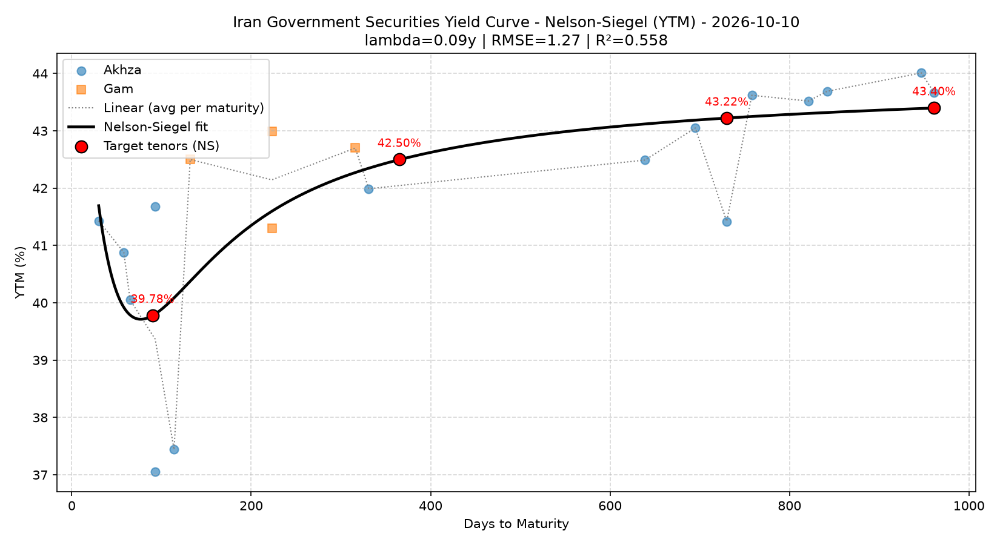

# FDL-001: Estimation of the Risk-Free Rate from Iranian Fixed-Income Market Data

A Python project that estimates the risk-free rate for short-, medium- and long-term horizons directly from Iranian government securities market data (Akhza and Gam), by fitting a Nelson-Siegel yield curve.

**Author:** Khashayar Jamshidi, Financial Data Analyst

---

## Overview

In emerging markets, there is no single, universally accepted risk-free rate. This project builds one from market data:

1. Downloads the yield table of government securities from the Iran Fara Bourse (IFB) website.
2. Cleans the data (stale prices, matured instruments, outliers).
3. Converts Jalali (Persian) dates and computes days to maturity.
4. Fits a Nelson-Siegel yield curve to the cleaned data.
5. Reads the risk-free rate at 90 days, 1 year, 2 years and the longest available maturity.
6. Saves everything (data, curves, parameters, chart) to Excel and PNG.

## Features

- Web scraping of the yield table with `requests` and `pandas.read_html`
- Persian text handling (encoding detection, Persian digits and `/` decimal separator)
- Jalali to Gregorian date conversion with `jdatetime`
- Data cleaning filters:
  - Excludes matured instruments
  - Drops stale prices (last trade too far from the latest trading day)
  - Drops instruments too close to maturity
  - Drops outliers using a minimum yield threshold
- Nelson-Siegel curve fitting (grid search over lambda, linear least squares for the betas)
- Linear interpolation curve for comparison
- Fit diagnostics: RMSE, R-squared and per-instrument residuals (rich/cheap vs. the curve)
- Excel report with multiple sheets and an embedded chart
- Automatic fallback file name if `Output.xlsx` is open or locked

## Requirements

- Python 3.9 or newer
- Packages: `requests`, `pandas`, `numpy`, `jdatetime`, `matplotlib`, `openpyxl`, `lxml`, `pillow`

```bash
pip install requests pandas numpy jdatetime matplotlib openpyxl lxml pillow
```

## Usage

```bash
python Risk_Free_Rate.py
```

The script prints the cleaning summary, fitted parameters and risk-free rates, saves `Yield_Curve.png` and `Output.xlsx`, and then opens the chart.

## Configuration

All settings are at the top of the script:

| Setting | Default | Description |
|---|---|---|
| `URL` | `https://www.ifb.ir/ytm.aspx` | Data source |
| `INCLUDE_WORDS` | `["اخزا", "گام"]` | Instrument families to keep. Use `["اخزا"]` only for a stricter benchmark |
| `EXCLUDE_WORD` | `"سررسید شده"` | Status text used to exclude matured instruments |
| `MAX_STALE_DAYS` | `5` | Maximum age (days) of the last trade relative to the latest trading day |
| `MIN_DAYS` | `7` | Minimum days to maturity |
| `MIN_YTM` | `20` | Outlier filter (percent) |
| `RATE_COL` | `"YTM"` | `"YTM"` or `"Simple Yield"`. Use the same one for all tenors |
| `TARGETS` | 90d, 1y, 2y | Tenors (in days) to estimate |
| `LAMBDA_GRID` | `0.05` to `10` (step `0.01`) | Search range for the Nelson-Siegel decay parameter (years) |
| `EXTRAPOLATE` | `False` | If `False`, tenors outside the data range return `NaN` |
| `OUTPUT_FILE` | `"Output.xlsx"` | Excel output name |

## Methodology

**Nelson-Siegel model**

```
y(t) = b0 + b1 * (1 - e^(-t/λ)) / (t/λ) + b2 * [ (1 - e^(-t/λ)) / (t/λ) - e^(-t/λ) ]
```

- `b0`: long-term level
- `b1`: slope (short-end rate is `b0 + b1`)
- `b2`: curvature
- `λ`: decay parameter (years)

For each `λ` in the grid, `b0`, `b1` and `b2` are solved by ordinary least squares; the `λ` with the lowest sum of squared errors is selected. This approach always converges and does not depend on an initial guess.

**Why YTM by default?** For long maturities of zero-coupon instruments, Simple Yield grows much faster than YTM and distorts the curve. Whichever you choose, use the same measure for all tenors.

## Output

`Output.xlsx` contains:

| Sheet | Content |
|---|---|
| `Clean Data` | Filtered instruments, with `NS Fitted` and `NS Residual` columns |
| `Linear Curve` | Average yield per maturity (linear interpolation reference) |
| `NS Parameters` | `b0`, `b1`, `b2`, `λ`, RMSE, R-squared, number of points |
| `NS Curve` | Fitted curve on a daily grid |
| `Risk-Free Rates` | Rates by tenor: Nelson-Siegel vs. linear interpolation |
| `Chart` | Yield curve chart |

`Yield_Curve.png` is the same chart as a standalone image.

<!-- Add a screenshot of your chart here:

-->

## Limitations

- The result depends on the quality of the source data. The model does not use trading volume, so illiquid instruments are not down-weighted.
- Mixing Akhza and Gam can reduce the fit quality. If `λ` hits the edge of the grid or R-squared is low, try Akhza only.
- Nelson-Siegel extrapolation beyond the observed maturity range is unreliable. That is why `EXTRAPOLATE` is off by default.
- The IFB page layout may change. If the script fails, check the table index (`tables[1]`), column positions and header names.
- Which instruments count as "risk-free" is a methodological choice, not a fact.

## Disclaimer

This project is for educational and analytical purposes. It is not investment advice and is not a substitute for official reference rates.
